<p align="center">
  
</p>

<h1 align="center">Slate</h1>

<p align="center">
  <b>A fast media player for reviewing footage before you edit it.</b><br>
  Plays almost anything, and adds the tools a YouTube editor actually reaches for:<br>
  frame stepping, selects that go straight onto a DaVinci Resolve timeline, transcripts you can search across<br>
  a whole shoot, lossless clip cutting, loudness and tempo, and YouTube downloads at the best quality on offer.
</p>

<p align="center">
  <a href="https://github.com/Aztr1xX/Slate/releases/latest/download/Slate-Setup.exe"></a>
</p>

<p align="center">
  <a href="https://github.com/Aztr1xX/Slate/releases/latest"></a>
  <a href="https://github.com/Aztr1xX/Slate/actions/workflows/windows.yml"></a>
  
  
</p>

<p align="center">
  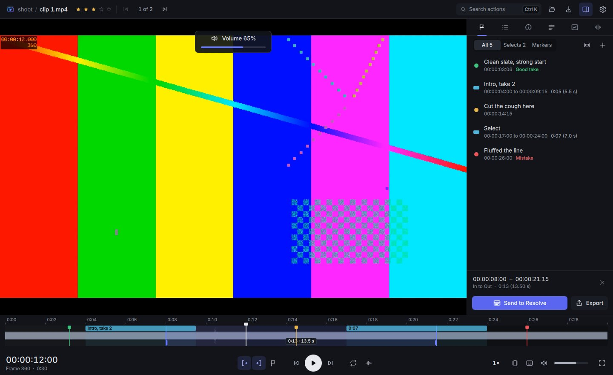
</p>

---

## Contents

- [Why Slate](#why-slate)
- [Features](#features)
- [Screenshots](#screenshots)
- [Install](#install)
- [A typical review session](#a-typical-review-session)
- [Keyboard shortcuts](#keyboard-shortcuts)
- [Sending selects to DaVinci Resolve](#sending-selects-to-davinci-resolve)
- [Build from source](#build-from-source)
- [How it is built](#how-it-is-built)
- [Troubleshooting](#troubleshooting)
- [Licence](#licence)

## Why Slate

Before editing a video you usually sit through every raw clip once: finding the good takes, noting
mistakes, checking the audio and pulling out the bits worth keeping. A normal media player can play the
files but forgets everything you noticed. An editor can do it all, but it is slow to open and makes you
import everything first.

Slate sits in between. Open a file or a whole folder from Explorer, step through it frame by frame,
drop markers and selects as you go, rate each take, then send the selects to DaVinci Resolve as a ready-made
timeline that links to your original files. It is built on **libmpv** (the engine behind mpv) with **FFmpeg** for analysis,
so it opens practically any video or audio format, and uses a modern **Qt 6** interface.

## Features

### Playback
- Plays video, audio and URLs (through yt-dlp), with hardware decoding where it is reliable.
- Drop a file or a folder. A folder becomes the clip list, in natural order (clip 2 before clip 10).
- **J / K / L** shuttle, 0.25× to 4× speed with pitch kept, and **skip silences** while playing.
- Resumes long files where you left off, and reuses the open window when you open another file from Explorer.
- Media keys work, and your own `mpv.conf` and scripts are picked up.

### Reviewing
- **Frame accurate**: step frames both ways, SMPTE timecode and frame number, exact seeks on release.
- **Go to a time** (Ctrl + G, or click the big timecode): type `90`, `1:30`, `00:01:30:12`, `f450` for a frame,
  or `+5` / `-2` to jump relative to where you are.
- **Timeline** with the audio waveform, In / Out range, markers and a hover preview of the frame.
  Drag the In and Out edges to adjust them; they snap to markers (hold Shift to stop snapping), and the
  range shows its length. Click a marker to jump to it and hover it to read its note.
  Ctrl + wheel zooms around the pointer, double-click resets.
- **Markers** in three kinds (Note, Good take, Mistake) with notes, saved automatically for each file.
  **Shift + M** drops a Good take and **Alt + M** a Mistake in one press.
- **Selects**: press **S** at the start and again at the end of a part worth keeping (or press S with an In and
  Out set). Selects show as blue bars on the timeline; drag their ends to adjust them, and they snap to
  markers, In / Out and beats. The Markers panel filters to All, Selects or Markers.
- **Undo and redo** (Ctrl + Z, Ctrl + Shift + Z or Ctrl + Y) for markers, selects, notes, ratings and In / Out.
  A drag is one step. The overlay says what was undone.
- **Your notes follow your files.** Markers, selects, ratings and tempo are kept by each file's contents, so
  they survive moving or renaming the footage. A hidden `.slate-review.json` in the clip's folder also
  carries them to another drive or computer (turn it off in **Settings → General**).
- **Instant feedback**: a small overlay at the top confirms volume, speed, In / Out, loop and marker changes,
  so you never have to look away from the picture to check what a key did.
- **Right-click the picture** for the common actions (markers, In / Out, copy or save the frame, zoom, crop guide).
- **Star rating in the header** for the clip you're watching, plus the 1 to 5 keys.
- **Clips panel** with thumbnails, durations, 1 to 5 star ratings and a rating filter. Each clip shows how
  many selects it has and whether it has a transcript or an Explorer thumbnail.
  Right-click a clip to **compare it side by side** with the current one.
- **Crop guide** (G): a 9:16, 4:5 or 1:1 frame over the picture, draggable sideways, to see if a shot works as a Short.
- **Picture zoom**: Ctrl + scroll zooms at the pointer, drag to pan, Z toggles 200% and fit.

### Analysis
- **Media info**: codec, resolution, real frame rate (it flags variable frame rate, which causes audio
  drift in editors), colour and HDR, bitrate, and loudness in LUFS compared with YouTube's −14 LUFS.
- **Video scopes**: luma waveform, RGB parade, histogram and vectorscope, drawn off the UI thread so playback stays smooth.
- **Audio levels**: a live left and right peak meter and the whole clip's loudness, true peak and range.
  Listen to the left or right channel alone to check each mic.
- **Transcript**: runs on your own computer with whisper.cpp (it downloads a speech model the first time).
  Click a line to jump there, search it, or save it as SRT subtitles or plain text.
  Right-click a line to make it a select.
- **Search a whole shoot** (Ctrl + F): **Transcribe all** works through every clip in the folder in the
  background while you keep reviewing. Then switch to **All clips** and search what was said in all of them;
  a result opens that clip at that line.
- **Repeated takes**: Slate finds lines you said more than once (including takes you stopped part-way), marks
  the last full take as the best, and one click adds a Good take marker on it and Mistake markers on the rest.
- **Music tools** (Audio and music tab): the tempo is found by listening (music files do this as they open),
  or tap it with **B**, or type it. Halve or double it, set the first beat, and pick 3, 4 or 6 beats a bar.
  **Shift + B** shows a beat grid on the timeline that markers, In / Out and selects snap to, and
  **Add beat markers** drops one on every beat, bar, 2 bars or 4 bars (optionally only between In and Out).
- **Spectrogram**: audio files can show a spectrogram instead of the waveform, to spot hum, hiss or clipping.

### Downloading
- **Download from YouTube** (Ctrl + D, or the download button in the header): paste a link, pick a format
  and a resolution. Slate takes the highest resolution, frame rate and audio quality the video has and joins
  them without re-encoding wherever the format allows.
- Video as **MP4, MKV, WebM, MOV or AVI**, or audio only as **MP3, M4A, WAV, FLAC, Opus or OGG**.
- An option makes MP4 files open in any editing app (H.264 and AAC): YouTube's H.264 stream is used when it
  has one at the chosen size, otherwise the video is converted at a visually lossless setting.
- Downloads carry on in the background while you review; the header shows the progress, and the file opens in
  Slate when it's done. Most other video sites work too.

### Exporting
- **Send to DaVinci Resolve** (Ctrl + R): builds an FCPXML timeline from your selects, with markers in their
  colours. Choose which clips (this clip, the folder, rated clips, clips with selects), whether to use selects or
  whole clips, the order (folder, best rated, time shot, name, length, or drag your own; reverse any of them),
  handles, gaps, which markers and where they go, clip names, frame rate and resolution. A live preview shows
  the timeline before you save it, and your choices and custom order are remembered.
- **Cut In to Out** losslessly (instant, no quality loss) or frame-exact (re-encoded), or **every select** as
  its own clip in one go.
- **Thumbnail frames** (Ctrl + T): Slate looks through the clip and offers the 12 sharpest, best-lit frames,
  spread out. Save one as a full-size PNG or a 1280×720 YouTube thumbnail (under YouTube's 2 MB limit), copy
  it, or **make it the file's thumbnail in File Explorer** (MP4, MOV, M4V and MKV; nothing is re-encoded,
  dates and notes are kept, and it can be removed again). Right-click the picture to use the frame on screen.
- **Markers** as an EDL for DaVinci Resolve, as CSV, or copied as **YouTube chapters** (checked against YouTube's rules).
- **Current frame** saved as PNG, or copied to the clipboard with Ctrl + C to paste anywhere.
- Exports go to a `Slate exports` folder beside the clip, so they don't end up in the clip list.
  Pick a different folder in **Settings → Exports**.

### Everyday comforts
- **Command palette** (Ctrl + K) to search every action. Actions you use often come first.
- **Resizable side panel**: drag its left edge (double-click to reset). Hover a tab icon to see its name; tabs only load when you open them.
- **A calm, consistent look**: slate greys taken from the app icon, one accent colour, and its own copy of the Inter typeface with fixed-width numbers, so timecodes line up and don't jiggle while they count.
- **Fast on any computer**: analysis runs at low priority so playback never stutters, and
  **Settings → Playback → Lighter video rendering** trades a little scaling sharpness for much less GPU work on older laptops.
- **Fully remappable shortcuts** in **Settings → Shortcuts**.
- **Built-in updates**: Slate checks GitHub for a new version, downloads it in the background and installs it when you restart.
- **Error log and crash reports**: warnings and errors go to a log on your computer, and if Slate ever crashes
  it saves a report and offers to copy the details next time it starts. **Settings → About → Error log**.
- Explorer integration: **Open with → Slate**, **Review folder in Slate** on folders, and an option to make Slate the default player.

## Screenshots

<p align="center">
  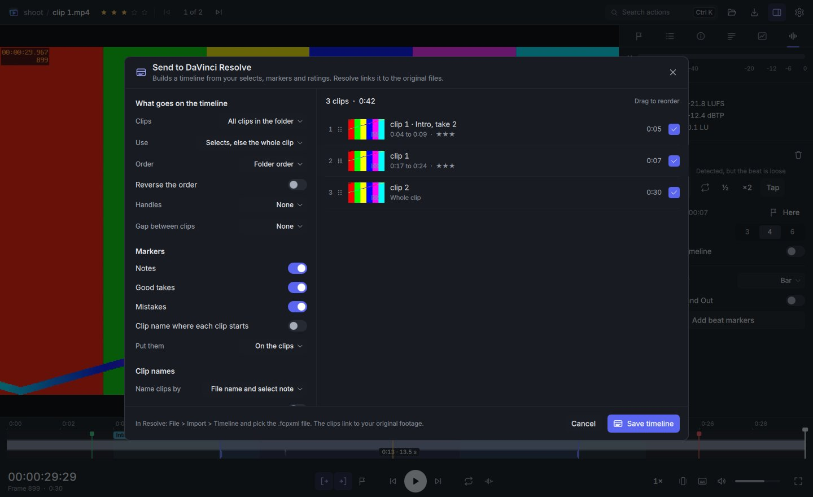<br>
  <b>Send to DaVinci Resolve</b>: your selects as a timeline, in the order you choose
</p>

<p align="center">
  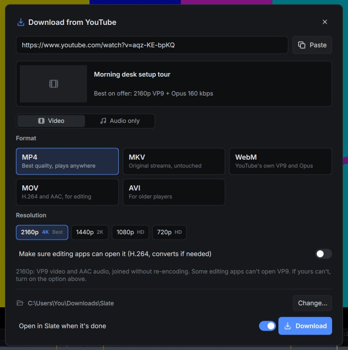<br>
  <b>Download from YouTube</b>: pick a format and resolution, and Slate gets the best streams on offer
</p>

| | |
| --- | --- |
| 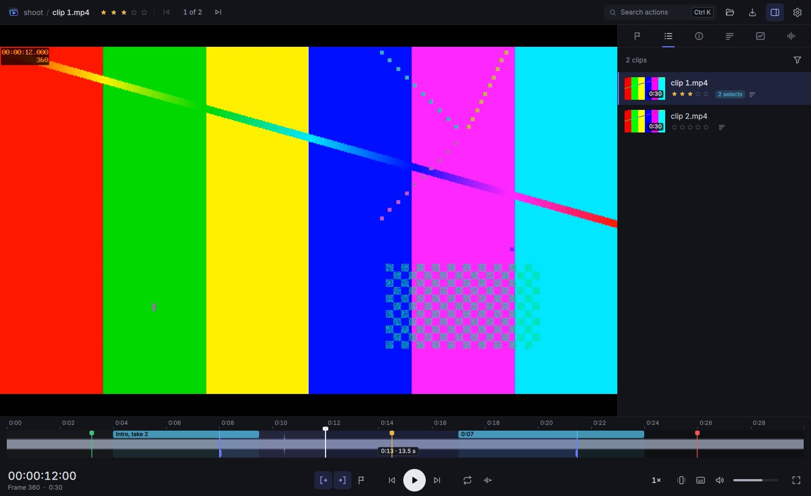<br>**Clips** with thumbnails and star ratings | 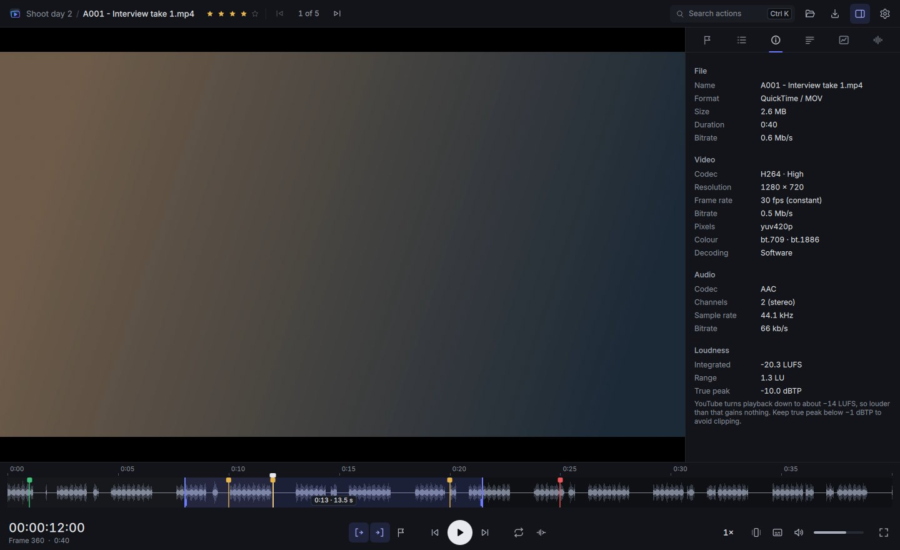<br>**Media info**, including loudness and variable frame rate checks |
| 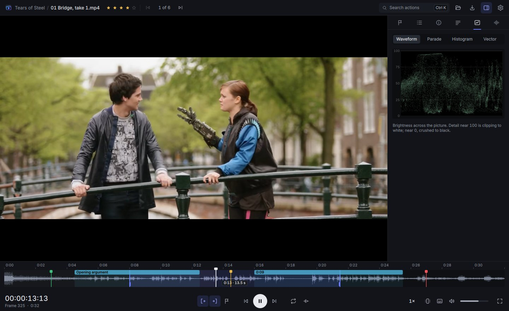<br>**Scopes**: waveform, parade, histogram and vectorscope | 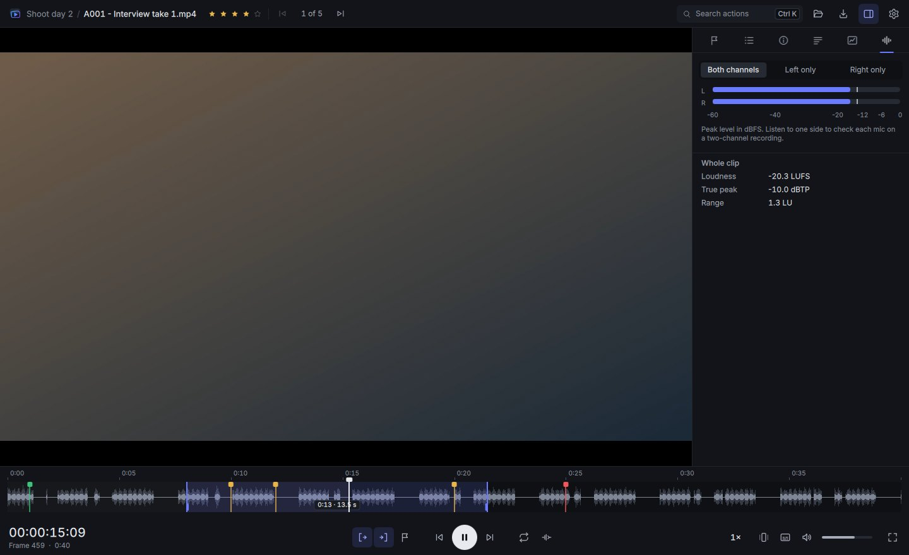<br>**Audio levels** with loudness, true peak and range |
| 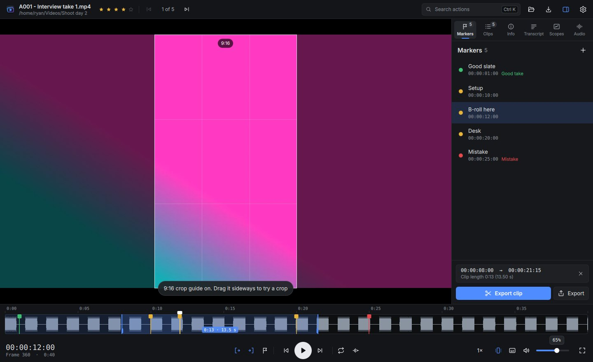<br>**Crop guide** for checking Shorts framing | 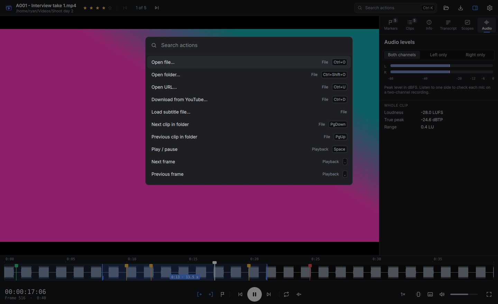<br>**Command palette** for every action |
| 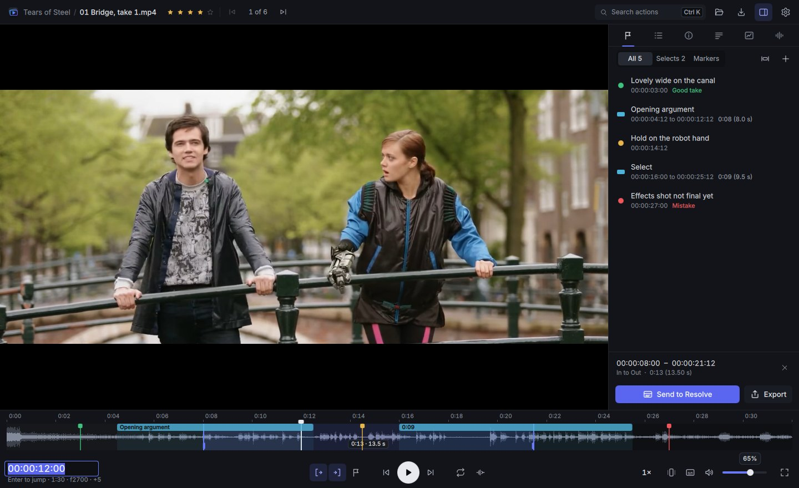<br>**Go to a time** by typing it into the timecode | 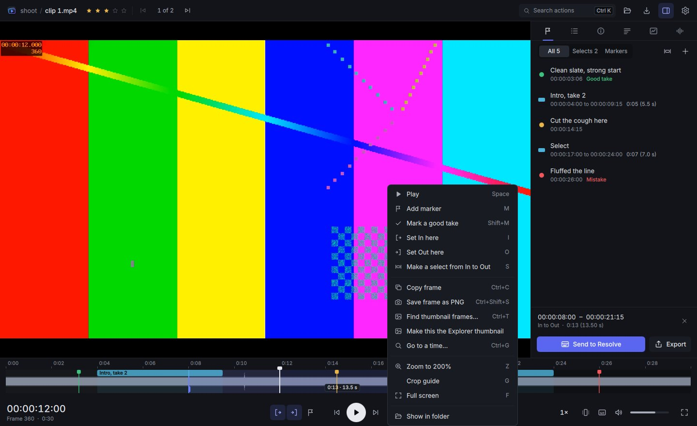<br>**Right-click menu** on the picture |
| 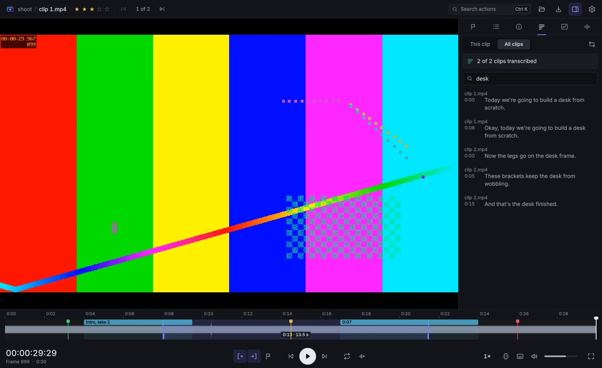<br>**Search every clip's transcript** | 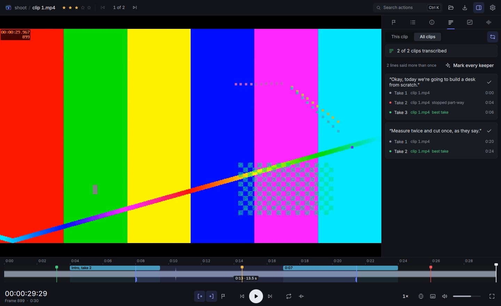<br>**Repeated takes**, with the best one picked out |
| 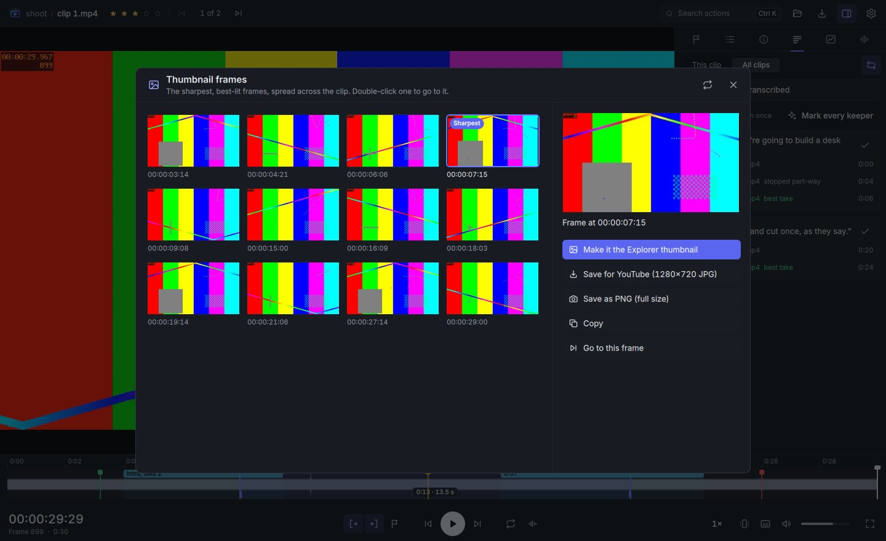<br>**Thumbnail frames**, also as the Explorer thumbnail | 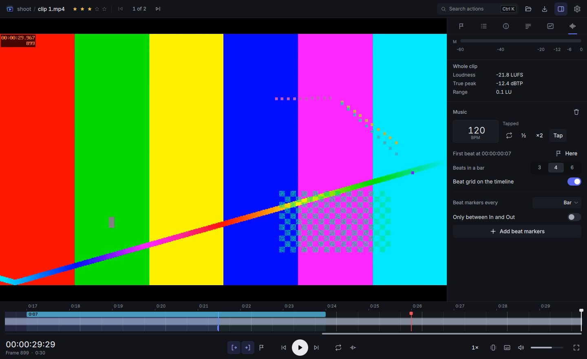<br>**Music tools**: tempo, tap, beat grid and beat markers |
| 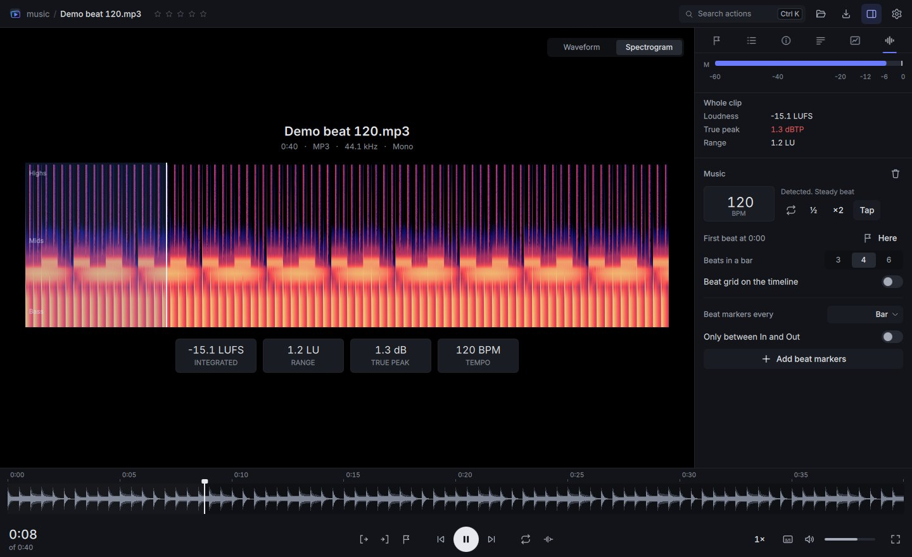<br>**Spectrogram** for audio files | <br>**Selects** on the timeline and in the Markers panel |
| 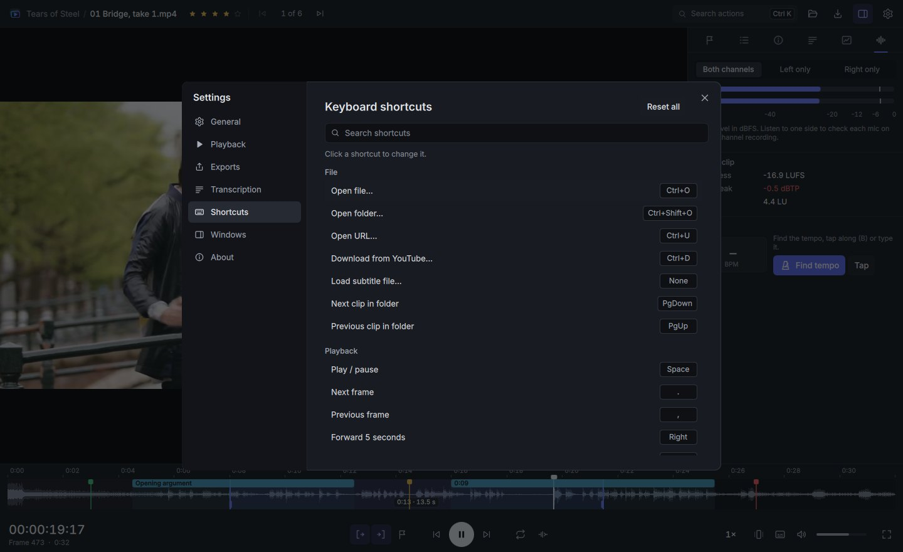<br>**Remappable shortcuts** | 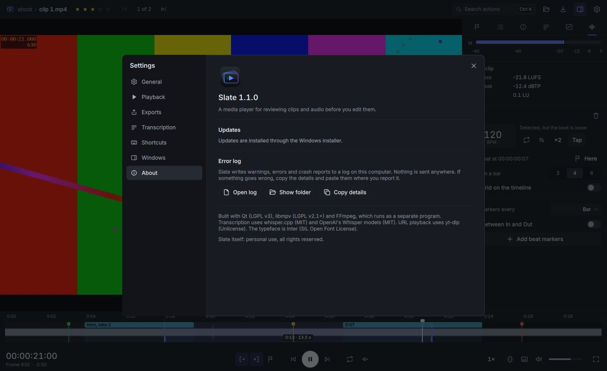<br>**Updates** handled inside the app |

## Install

Slate runs on 64-bit Windows 10 and 11.

1. Download **[Slate-Setup.exe](https://github.com/Aztr1xX/Slate/releases/latest/download/Slate-Setup.exe)**.
2. Run it. SmartScreen warns because the app isn't code-signed: choose **More info → Run anyway**.
   Pick **Install for me only** (no admin needed) or for all users.
3. Leave **Make Slate my default video player** ticked on the last page. Windows Settings opens on
   Slate's page: press **Set default** at the top (Windows 11), or pick Slate for each file type you want.
   You can do this later from **Settings → Windows → Open Default apps**.

The installer also adds:

- a Start menu entry (and a desktop shortcut if you tick it), and an uninstaller in Settings → Apps
- **Open with → Slate** for video and audio files
- **Review folder in Slate** on the folder right-click menu (Windows 11: under "Show more options")
- `ffmpeg`, `ffprobe`, `whisper-cli` (transcription) and `yt-dlp` (URLs and downloads), so nothing else needs installing.
  The first YouTube download also fetches Deno (about 45 MB), which yt-dlp needs to see YouTube's top resolutions

Prefer not to install? Every release also has **Slate-portable.zip**: unzip it anywhere and run `Slate.exe`.

### Updates

A few seconds after it starts, Slate checks the [latest release](https://github.com/Aztr1xX/Slate/releases/latest)
and downloads anything newer in the background. When it is ready, a **Restart to update** button appears in
the top bar: Slate closes, installs the update silently and reopens. Settings, markers and ratings are kept.
Turn off automatic downloads, or check by hand, in **Settings → About**.

## A typical review session

1. Right-click the folder of raw clips in Explorer and choose **Review folder in Slate**.
2. Play the first clip. Press **M** to drop a marker whenever something happens (**Shift + M** for a good take,
   **Alt + M** for a mistake). Press **S** at the start and end of each part worth keeping. Press **1** to **5** to rate the take.
3. Use **,** and **.** to find the exact frame and drag a select's ends on the timeline to tighten it. Made a mistake? **Ctrl + Z**.
   For talking-head footage, **Transcribe all** in the Transcript tab and use **Repeated lines** to keep the best take of each line.
4. Check the **Info** tab for loudness and variable frame rate, and the **Audio levels** tab to make sure both mics recorded.
5. Press **PgDn** for the next clip. When you're done, filter the Clips panel by rating to see your best takes.
6. Press **Ctrl + R**, check the timeline preview, and **Save timeline**. Import it in Resolve (below) and start editing.

## Keyboard shortcuts

These are the defaults. Every one can be changed in **Settings → Shortcuts**, and **Ctrl + K** finds any action by name.

| Key | Action |
| --- | --- |
| Space | Play / pause |
| , and . | Previous / next frame |
| ← → | Back / forward 5 s (with Shift: 1 s) |
| Home / End | Go to start / end |
| Ctrl + G | Go to a typed time or frame |
| J K L | Rewind / stop / play (press L again to go faster) |
| [ ] = | Slower / faster / normal speed |
| Ctrl + Shift + K | Skip silences |
| ↑ ↓, Ctrl + M | Volume up / down, mute |
| I, O, X | Set In, set Out, clear both |
| Ctrl + L | Loop between In and Out |
| M, Shift + M, Alt + M | Add a note, good take or mistake marker |
| S | Start or end a select (with In and Out set: turn them into a select) |
| Ctrl + Z, Ctrl + Shift + Z or Ctrl + Y | Undo, redo |
| Ctrl + R | Send to DaVinci Resolve |
| Ctrl + F | Search what's said (transcripts) |
| Ctrl + T | Find thumbnail frames |
| B, Shift + B | Tap the tempo, beat grid on or off |
| Ctrl + ← / Ctrl + → | Previous / next marker |
| 1 to 5, 0 | Rate the clip, clear the rating |
| Ctrl + E | Export In to Out losslessly (Ctrl + Shift + E: frame-exact) |
| Ctrl + Shift + S | Save the current frame as PNG |
| Ctrl + C | Copy the current frame |
| PgUp / PgDn | Previous / next clip in the folder |
| Ctrl + O, Ctrl + Shift + O, Ctrl + U | Open file, folder, URL |
| Ctrl + D | Download from YouTube |
| Ctrl + = / Ctrl + - / Ctrl + 0 | Zoom the timeline in / out / show all |
| Z | Zoom the picture to 200% / back to fit |
| G | Crop guide on or off |
| Alt + 1 to 6 | Markers, clips, info, transcript, scopes, audio and music |
| H | Hide the side panel |
| F, F11 or double-click | Full screen |
| Ctrl + K | Search all actions |
| Esc | Cancel a select in progress, leave full screen, comparison, zoom or the crop guide |
| ? | Show the shortcut list |
| Ctrl + , | Settings |

## Sending selects to DaVinci Resolve

1. In Slate, press **Ctrl + R** (or **Send to Resolve** under the Markers panel). Pick what goes on the timeline
   and in what order, and press **Save timeline**. It's saved as an `.fcpxml` file in the `Slate exports` folder.
2. In Resolve: **File → Import → Timeline…** and pick the file. Resolve adds the clips to the Media Pool and
   builds the timeline, linked to your original footage (no copies, no re-encoding). Markers keep their colours
   (Note = yellow, Good take = green, Mistake = red, Select = blue) and their notes.
3. If you chose **Put them: On the timeline, coloured** for markers, also import the `markers.edl` saved beside it with
   **Timelines → Import → Timeline Markers from EDL…** on the new timeline.

To use selects in another app, set **Make** to **Each clip as a file** (or both) and Slate cuts each one losslessly.

### Markers for one clip

1. In Slate, choose **Export → Markers for DaVinci Resolve (EDL)**.
2. In Resolve, open the clip's timeline, right-click the timeline in the Media Pool and choose
   **Timelines → Import → Timeline Markers from EDL…**, then pick the exported file.

Colours carry over (Note = yellow, Good take = green, Mistake = red, Select = blue, with its length), and
marker notes become the marker names. The EDL starts at 01:00:00:00 to match Resolve's default timeline start.

## Build from source

### The easy way: GitHub Actions

Every push runs [`.github/workflows/windows.yml`](.github/workflows/windows.yml), which:

1. builds Slate with Qt 6.8 and MinGW against the LGPL libmpv build,
2. runs the unit tests and an automated self-test of the packaged app on a pair of generated clips,
3. builds the installer with Inno Setup ([`packaging/windows/slate.iss`](packaging/windows/slate.iss)) and a portable zip,
4. on `main`, publishes them as a new release (version `1.1.<run number>`), which installed copies then update to.

Changes that only touch documentation (`*.md`, `docs/`) skip the workflow, so they don't push an update to everyone.

### By hand on Windows

1. Install Qt 6.8 (MinGW 64-bit) with the Qt online installer.
2. Download `mpv-dev-lgpl-x86_64-*.7z` from [zhongfly/mpv-winbuild](https://github.com/zhongfly/mpv-winbuild/releases)
   and unpack it to `deps\mpv`.
3. In a Qt MinGW terminal:

   ```bat
   cmake -S . -B build -G "MinGW Makefiles" -DCMAKE_BUILD_TYPE=Release -DMPV_DIR=%CD%\deps\mpv
   cmake --build build --parallel
   ```

4. Put `libmpv-2.dll`, `ffmpeg.exe` and `ffprobe.exe` (and optionally `whisper-cli.exe` with its DLLs, and
   `yt-dlp.exe`) next to `Slate.exe`, then run `windeployqt --qmldir qml Slate.exe`.

### On Linux (for development)

```sh
sudo apt install qt6-base-dev qt6-declarative-dev qt6-svg-dev libmpv-dev ffmpeg cmake ninja-build \
  qml6-module-qtquick-controls qml6-module-qtquick-layouts qml6-module-qtquick-dialogs \
  qml6-module-qtquick-window qml6-module-qtqml-workerscript qml6-module-qtquick-templates
cmake -S . -B build -G Ninja && cmake --build build
./build/slate_tests                        # unit tests
./build/slate --selftest some-clip.mp4     # drives the real app through the review workflow
./build/slate --tour shots/ some-clip.mp4  # saves a screenshot of every screen
```

The screenshots in this README were made with `--tour`.

## How it is built

```
src/
  mpvobject.*      the only code that talks to libmpv; renders into Qt Quick through mpv's
                   OpenGL render API and exposes playback state as properties
  media.*          background analysis with ffmpeg / ffprobe (waveform, loudness, thumbnails,
                   stream facts), cached per file
  visuals.*        waveform and scope drawing
  transcript.*     whisper.cpp transcription, the background queue, search and repeated takes
  resolveexport.*  probes clips and writes the Resolve timeline
  thumbnails.*     best-frame picking, YouTube thumbnails, cover art for Explorer
  tempo.*          tempo and first-beat detection, spectrogram
  logger.*         error log and crash reports
  appcontroller.*  clip list, resume points, In / Out, ratings, settings, exports
  updater.*        checks GitHub releases, downloads and runs the installer silently
  markermodel.*    markers, selects and their EDL / CSV / chapter output } pure logic,
  reviewstore.*    review notes kept by file contents, plus sidecar  } unit tested
  undostack.*      undo and redo                                     } in tests/
  fcpxml.*         FCPXML timeline writing                           }
  timecode.*       SMPTE timecode and frame maths                  } unit tested
  folderqueue.*    natural-order clip lists                        } in tests/
  icons.*          the interface's icon set
  main.cpp         start-up, single-window handling, --selftest and --tour
qml/               the interface (Main.qml plus one file per panel and control)
assets/            app icon in SVG, PNG and ICO
packaging/windows/ installer script, icon and version resource
tests/             unit tests (Qt Test)
docs/screenshots/  images used in this README
```

## Troubleshooting

- **SmartScreen blocks the installer.** Slate isn't code-signed. Choose **More info → Run anyway**.
- **Something went wrong.** **Settings → About → Error log** has the log (`%LOCALAPPDATA%\Slate\Slate\logs\slate.log`)
  and any crash reports. **Copy details** puts the useful part on the clipboard.
- **A file plays badly or not at all.** mpv's warnings are in the error log. For more detail, set the environment
  variable `SLATE_MPV_LOG=1` and start Slate from a terminal. Hardware decoding can be turned off in **Settings → Playback**.
- **Custom mpv settings.** Your own `mpv.conf` and scripts go in the folder shown in **Settings → Playback**.
- **Transcription does nothing.** The first run downloads a speech model, so it needs an internet connection once.
- **Resolve says it can't find the media.** The timeline links to the files where they were when you saved it.
  If you moved them since, save the timeline again, or use Resolve's **Relink** on the clips.
- **The Explorer thumbnail doesn't change.** Explorer caches thumbnails. Press F5 in the folder, or wait a moment.
  For MKV files Explorer needs a thumbnail add-on such as Icaros.
- **The tempo is half or double.** Press **½** or **×2**. For loose or live music, tap along with **B** instead.
- **A YouTube download fails.** Slate keeps yt-dlp up to date by itself (once a day), which fixes most
  failures after YouTube changes something. Age-restricted and private videos can't be downloaded. The error
  message says what went wrong, and the full yt-dlp output of the last download is in
  `%LOCALAPPDATA%\Slate\Slate\download.log`.
- **Audio drifts in your editor.** Check the **Info** tab: variable frame rate footage is flagged there.
  Re-encoding it to a constant frame rate before editing fixes the drift.

## Licence

Slate is a personal project. Copyright © 2026 Ryan Mendes, all rights reserved. See [LICENSE](LICENSE).

Slate uses Qt and libmpv under the LGPL, and ships FFmpeg, whisper.cpp and yt-dlp as separate programs under
their own licences. See [THIRD_PARTY_NOTICES.md](THIRD_PARTY_NOTICES.md) for details. See
[CHANGELOG.md](CHANGELOG.md) for what changed in each version.
